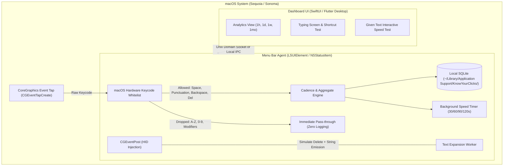

# macOS Implementation Plan: KnowYourClicks

## 1. System Overview & Platform Architecture

On macOS, keyboard monitoring and system integration rely on CoreGraphics Event Taps and the Cocoa Menu Bar ecosystem. The application is architected as a **Menu Bar Agent (Daemon)** paired with a **SwiftUI / Flutter Desktop GUI**.

---

## 2. Privacy-First Event Tap Whitelist Filter

To strictly satisfy:
> *"sense only spacebar, punctuation marks, and backspace and delete keys. others shouldn't be sensed by the app for privacy reasons."*

The macOS listener is implemented via `CGEventTapCreate` listening for `kCGEventKeyDown`. Inside the `CGEventTapCallBack`, the keycode is extracted using `CGEventGetIntegerValueField(event, kCGKeyboardEventKeycode)` and checked against an immutable whitelist.

### Whitelisted macOS Hardware Keycodes (`HIToolbox/Events.h`)
| Category | Virtual Keycode | Hex Value |
| :--- | :--- | :--- |
| **Space** | `kVK_Space` (Spacebar) | `0x31` (49) |
| **Editing** | `kVK_Delete` (Backspace) | `0x33` (51) |
| | `kVK_ForwardDelete` (Delete) | `0x75` (117) |
| **Punctuation** | `kVK_ANSI_Period` (`.`) | `0x2F` (47) |
| | `kVK_ANSI_Comma` (`,`) | `0x2B` (43) |
| | `kVK_ANSI_Slash` (`/`) | `0x2C` (44) |
| | `kVK_ANSI_Semicolon` (`;`) | `0x29` (41) |
| | `kVK_ANSI_Quote` (`'`) | `0x27` (39) |
| | `kVK_ANSI_Grave` (`` ` ``) | `0x32` (50) |
| | `kVK_ANSI_LeftBracket` (`[`) | `0x21` (33) |
| | `kVK_ANSI_RightBracket` (`]`) | `0x1E` (30) |
| | `kVK_ANSI_Backslash` (`\`) | `0x2A` (42) |
| | `kVK_ANSI_Minus` (`-`) | `0x1B` (27) |
| | `kVK_ANSI_Equal` (`=`) | `0x18` (24) |
| **Alphanumerics (A-Z, 0-9)** | **BLOCKED & DROPPED** | Forwarded immediately without logging |

If the keycode does not match the whitelist, the callback exits immediately and returns the original event untouched. **No character translation or buffer memory is ever allocated for alphanumeric keys.**

### macOS Privacy Permissions
macOS requires explicit **Accessibility Permissions**:
* The daemon checks status with `AXIsProcessTrustedWithOptions()`.
* If not authorized, it presents a native prompt directing the user to:
  `System Settings > Privacy & Security > Accessibility > Allow KnowYourClicks`.

---

## 3. Features & Logic

### A. Text Expander & Shortcut Option (on Space Key)
* **Typing Screen**:
  - The typing screen records words typed inside the application.
  - When `kVK_Space` is pressed, the preceding word is compared to the `shortcuts` SQLite table.
  - If a match is found (e.g., `idk`), it replaces the typed snippet with `i dont know `.
* **System-Wide Expansion (via CGEventPost)**:
  - If global expansion is enabled:
    1. Emits $N \times$ delete events using `CGEventCreateKeyboardEvent(..., kVK_Delete, true)`.
    2. Inserts the expanded text string using `CGEventKeyboardSetUnicodeString`.

### B. Timed Typing Speed Tracker
Only runs when explicitly activated.
* **Durations**: `30s`, `60s`, `90s`, `120s`.
* **Option 1: Try with Given Text (In-App)**:
  - Interactive typing test displaying prompt passages.
  - Measures Words Per Minute (WPM), accuracy %, and error correction habits.
* **Option 2: Measure in the Background**:
  - Triggered via the Menu Bar Extra or keyboard hotkey (e.g., `Cmd + Option + K`).
  - Passively monitors typing speed while the user works in Safari, Xcode, Notes, or Mail.
  - Privacy-preserving speed calculation:
    $$\text{Words Counted} = \text{Count}(\text{kVK\_Space}) + \text{Count}(\text{Punctuation Delimiters})$$
    $$\text{WPM} = \frac{\text{Words Counted}}{\text{Duration in Minutes}}$$
  - Displays a native macOS User Notification (`UNUserNotificationCenter`) with the speed badge when finished.

### C. Local Analytics & Statistics (Zero Cloud)
* **Storage Location**: `~/Library/Application Support/KnowYourClicks/stats.db`.
* **Analytics Views**:
  - **1 Hour**: Minute-by-minute activity of Spaces vs. Backspaces/Deletes.
  - **1 Day**: Hourly distribution showing focus and typing bursts.
  - **1 Week**: Daily totals and editing density ratio.
  - **1 Month / All-Time**: Monthly volume, top punctuation marks, and historical speed curves.

---

## 4. Background Service & Lifecycle

* **Menu Bar Agent (`NSStatusItem`)**:
  - Sets `LSUIElement = true` in `Info.plist` to run cleanly without cluttering the macOS Dock.
  - Resides permanently in the top menu bar with a quick timer dropdown (30s, 60s, 90s, 120s).
* **Autostart Support**:
  - Configured using modern macOS `SMAppService.mainApp.register()` or a LaunchAgent plist:
    `~/Library/LaunchAgents/com.knowyourclicks.daemon.plist`.

---

## 5. macOS Tech Stack Recommendation
* **Background Worker**: Swift / Objective-C with CoreGraphics (`CGEventTap`) and Cocoa (`NSStatusItem`).
* **Frontend GUI**: SwiftUI or Flutter Desktop (macOS runner).
* **Database**: Local SQLite 3 via `GRDB.swift` or standard `sqlite3` C API.
